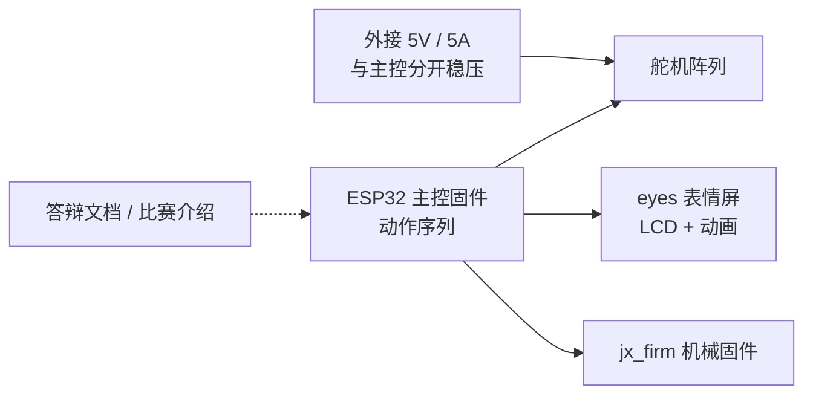

# ESP32 舞蹈机器人

**主控固件 + 表情屏 + 机械固件 + 答辩材料：一台能完整演示的参赛整机**

[快速开始](#3-快速开始与关键实现) · [常见问题](#4-常见问题) · [全部仓库索引](https://github.com/xhtfps/xhtfps)

## 一台整机，四条线

比赛现场翻车通常不是代码写错，而是**供电、中位、时序**三件事没排干净。这个仓库把主控固件、视觉表情模块、机械固件与答辩文档放在一起，让「改动作 → 标中位 → 上电演示」这条线可以完整复现。

## 亮点

- **动作序列先在串口验**：确认步进与舵机角度范围后再接机械，避免卡死烧舵机。
- **供电单独说清**：舵机与主控分开稳压、共地不共电源，多路同时动作的电压跌坑有明确解法。
- **表情屏独立模块**：`eyes/` 只做 LCD 驱动与动画，出问题不必动主控。
- **答辩材料在仓里**：方案抽讲 PDF 与答辩稿同仓维护，评分点对着看。

## 结构

## 1. 目录一览

| 目录/文件 | 内容 |
| --- | --- |
| `ESP32/` | ESP-IDF 主控固件（舵机控制、动作序列、通信） |
| `eyes/` | 视觉/表情模块（LCD 驱动与动画） |
| `jx_firm/` | 机械结构固件 |
| `舞蹈机器人.pdf` | 比赛介绍与方案抽讲 |
| `舞蹈机器人比赛介绍与答辩文档.md` | 答辩稿与评分点 |
| `READ.txt` | 原目录说明（含烧录记录） |

## 2. 环境

| 项 | 要求 |
| --- | --- |
| 编译 | ESP-IDF 5.x（`idf.py`），主控为 ESP32 / ESP32-S3 |
| 串口驱动 | CH343 / CP210x |
| 硬件 | 舵机阵列（外接 5V 电源，与主控共地） |
| Python | 仅用于上位机调试脚本（可选） |

## 3. 快速开始与关键实现

1. 安装并激活 ESP-IDF：`$env:IDF_PATH=...; & "$env:IDF_PATH\export.ps1"`。
2. 进 `ESP32/`：`idf.py set-target esp32` → `idf.py build` → `idf.py -p COMx flash monitor`。
3. 动作序列先在串口里确认步进与舵机角度范围，再接机械结构，避免卡死烧舵机。
4. 关键点：舵机供电必须与主控分开稳压，共地但要隔离噪声；多路舵机同时动作会引起电压跌坑，导致 ESP32 重启。

## 4. 常见问题

- **烧录失败**：按住 BOOT 再上电进下载模式；USB 线换带数据的而不是充电线。
- **舵机抽搞 / 主控重启**：供电不足，加电容或换 5V/5A 外接电源。
- **动作跑偏**：舵机中位未标定，先写一遍中位标定再录动作序列。
- **eyes 屏幕白屏**：SPI 频率过高或引脚定义不匹配，降到 20 MHz 先验证。

## 5. 维护说明

- 已排除内容见 [`EXCLUDED_FILES.md`](EXCLUDED_FILES.md)；原 524 KB 逐文件 CSV 已删除。
- 原 `dancing-robot-multimodal` 仓库内容已归入本仓库。
- 第三方素材（比赛规则、音乐、芯片手册）版权归原作者，仅作参赛使用。
## 路线图

- [x] 主控、表情屏、机械固件三段工程齐备
- [x] 舵机中位标定与供电方案写入文档
- [ ] 补一份动作库 JSON，支持按曲目切换
- [ ] 增加上电自检脚本（逐路舵机小角度测试）

## 参与与反馈

- 遇到问题请走 [Issue 模板](.github/ISSUE_TEMPLATE)，注明舵机型号、供电方案与烧录日志。
- 提 PR 前先读 [CONTRIBUTING.md](CONTRIBUTING.md)；安全问题按 [SECURITY.md](SECURITY.md) 私下反馈。
- 如果这个仓库帮你省过时间，点个 ⭐ 是最省事的支持。

## 许可证

本仓自写代码见 [LICENSE](LICENSE)；比赛规则、音乐素材与芯片手册版权归原作者，仅作参赛使用。
